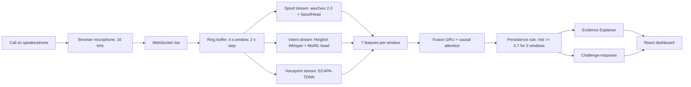

# RakshaVoice

**Real-time, explainable voice-call fraud detection: spoofed-voice detection, Hindi/English/Hinglish scam-intent analysis and voiceprint matching, fused over time by a custom GRU network. Audio is processed in memory and never stored.**


> **Research prototype.** The risk score is a model output, not a verified probability of fraud, and it is not legal evidence. See [Limitations](#limitations).

RakshaVoice is a personal project that I built to explore real-time, privacy-friendly protection against voice-call fraud. It listens to a phone call played on speakerphone through the laptop microphone and warns the user while the call is still in progress.

---

## Table of contents

1. [Why RakshaVoice](#why-rakshavoice)
2. [Features](#features)
3. [How it works](#how-it-works)
4. [Results at a glance](#results-at-a-glance)
5. [Repository structure](#repository-structure)
6. [Getting started](#getting-started)
7. [Using the dashboard](#using-the-dashboard)
8. [API reference](#api-reference)
9. [Evaluation and tests](#evaluation-and-tests)
10. [Privacy and legal design](#privacy-and-legal-design)
11. [Limitations](#limitations)
12. [Future work](#future-work)
13. [Author](#author)
14. [Acknowledgements and licence](#acknowledgements-and-licence)

---

## Why RakshaVoice

OTP scams, "digital arrest" calls and AI-cloned voices are among the fastest-growing cybercrimes in India, and most defences act only after the money has moved. Most research tools are also built for English speech and detect only synthetic audio, while most real fraud is a human operator applying pressure. RakshaVoice analyses the live conversation along three complementary signals and explains the risk in plain language.

## Features

- **Three parallel detection streams**
  - **Audio spoof detection:** frozen wav2vec 2.0 features and a custom-built, layer-weighted `SpoofHead`.
  - **Scam-intent analysis:** Hinglish Whisper speech recognition with a voice-activity filter and term repair, then a fine-tuned MuRIL model with a multi-label head (urgency, authority, OTP/PII request, payment).
  - **Voiceprint matching (optional):** ECAPA-TDNN embeddings compared with an enrolled contact.
- **Temporal Risk Fusion Network:** a GRU with causal attention (built and trained by me) that turns the stream of per-window scores into a risk value. An alert is raised only when risk stays at or above 0.7 for two consecutive windows.
- **Evidence Explainer:** converts the fusion evidence into a plain-language reason and a recommended action (rule-based, offline).
- **Challenge–response check:** the user asks the caller a pre-registered question. The verification data is stored in an encrypted file, and the answer only as a salted PBKDF2 hash.
- **Live dashboard (React + Vite):** risk gauge, persistence steps, alert banner, live transcript, signal chips, risk-over-time chart, three-signal radar, latency view, session summary, light and dark themes.
- **Live-only processing:** each 4-second window is scored in memory and discarded. No call recording is created.

## How it works



The seven fusion features per window are: `spoof`, `urgency`, `authority`, `otp_pii`, `payment`, `voice_mismatch` and `voice_active`.

| Component | Pretrained (frozen) | Built and trained by me |
| --- | --- | --- |
| Spoof stream | wav2vec 2.0 (`facebook/wav2vec2-base`) | SpoofHead (learned weights over 13 layers, calibration) |
| Intent stream | Hinglish Whisper (`Hub84/faster-whisper-hinglish-prime`), MuRIL encoder | Fine-tuned intent head, VAD settings, term repair |
| Voiceprint stream | ECAPA-TDNN (`speechbrain/spkrec-ecapa-voxceleb`) | Enrolment, thresholding, mismatch feature |
| Fusion | – | FusionGRU, simulator, training and live inference |
| Application | – | Streaming engine, alert logic, explainer, challenge–response, dashboard |

## Results at a glance

All numbers come from the saved result files in this repository. Please read them together with their conditions.

| Subsystem | Result | Condition |
| --- | --- | --- |
| Spoof detection | EER 2.44%, AUC 0.9972 | ASVspoof 2019 LA evaluation set (20,000 clips) |
| Spoof detection | EER 27.08%, AUC 0.7222 | In-the-Wild, 30 clips, first version (shows the benchmark-to-reality gap) |
| Speech recognition | Mean WER 0.153 (English 0.015, Hindi 0.190, Hinglish 0.255) | 54 self-recorded clips, GPU |
| Speaker verification | EER 0.45% to 1.69% | 360 target and 14,040 non-target trials, clean and phone quality |
| Intent (chunk level) | otp_pii F1 0.95, urgency F1 0.74 | 249-row gold set |
| Intent (whole transcript) | Exact match 17.7% | 300-record reviewed test set (weak; see Limitations) |
| Fusion (GRU) | Detected all scam sessions of the two real speakers; about 78% on TTS sessions | 42 recorded sessions, leave-one-group-out |
| Fusion vs baselines | No measurable advantage over MLP or intent-only | Small session set |
| Latency | About 1.2 to 1.5 s per window | RTX 3050 (4 GB), occasional outliers |

## Repository structure

```
RakshaVoice/
├── backend/            FastAPI service: WebSocket, chunker, explainer, challenge-response, tests
├── audio/              Spoof stream, retraining data preparation, replay and paired tests
├── nlp/                Hinglish ASR, intent stream, labelling and evaluation scripts
├── voice/              Voiceprint stream, enrolment CLI, public-trial and own-voice evaluation
├── fusion/             Simulator, FusionGRU / MLP training, live inference, session results
├── verification/       Challenge-response enrolment and encrypted storage
├── frontend/           React + Vite dashboard
├── main.py             Uvicorn entry point (imports backend.main:app)
├── requirements.txt    Python dependencies
├── results.md          Consolidated early results
└── *.csv, test_*.py    ASR batch results and batch-test scripts
```

## Getting started

### Prerequisites

- Python 3.10 or newer
- Node.js 20.19 or newer (required by Vite 8)
- A CUDA-capable NVIDIA GPU is strongly recommended (developed on an RTX 3050, 4 GB). On a CPU the system runs, but processing is slower than the 2-second window step.
- A microphone (and a phone on speakerphone for live demos)

### 1. Clone and install the backend

```bash
git clone https://github.com/<your-username>/RakshaVoice.git
cd RakshaVoice

python -m venv venv
# Windows:      venv\Scripts\activate
# Linux / macOS: source venv/bin/activate

# Install a PyTorch build that matches your hardware first (https://pytorch.org), then:
pip install -r requirements.txt
```

### 2. Add the model files

Trained weights, datasets and enrolled voices are **not stored in this repository** (see `.gitignore`). Place them as follows:

| File or folder | Purpose |
| --- | --- |
| `audio/models/spoof_head.pt`, `audio/models/calibration_v2.json` | Trained SpoofHead and its calibration |
| `nlp/models/intent_v4/` | Fine-tuned intent model (MuRIL head and config) |
| `fusion/models/fusion_gru.pt`, `fusion/models/fusion_config.json` | Trained fusion network and settings |

Download link for the trained files: **[add your link here, for example a GitHub Release, Google Drive or Git LFS]**.

The pretrained models (`facebook/wav2vec2-base`, the Hinglish Whisper model, the MuRIL encoder and `speechbrain/spkrec-ecapa-voxceleb`) download automatically from Hugging Face on first run, so the first start needs an internet connection.

### 3. Set the encryption key for challenge–response

The verification store is encrypted with a Fernet key supplied through an environment variable.

```bash
# generate a key once and keep it secret
python -c "from cryptography.fernet import Fernet; print(Fernet.generate_key().decode())"

# Windows (PowerShell):  $env:RV_VERIFICATION_KEY="<your-key>"
# Linux / macOS:         export RV_VERIFICATION_KEY="<your-key>"
```

### 4. Enrol a contact (optional, for voice matching and challenge–response)

```bash
python -m voice.enroll_cli          # records short samples; asks for explicit consent; stores only an embedding
python -m verification.enrollment   # registers a verification question and answer for an enrolled contact
```

Only enrol a person who has agreed. The recorded audio is not kept.

### 5. Start the backend

```bash
uvicorn main:app --host 127.0.0.1 --port 8000
```

### 6. Start the frontend

```bash
cd frontend
npm install
npm run dev
```

Open the address printed by Vite (usually http://localhost:5173).

> The frontend expects the backend at `http://127.0.0.1:8000` (WebSocket `ws://127.0.0.1:8000/ws`). If you change the port, update `API_URL` and `WS_URL` at the top of `frontend/src/App.jsx`.

## Using the dashboard

1. Open the dashboard and accept the first-launch notice.
2. (Optional) choose the contact the caller claims to be under **Voice verification**.
3. Press **Start monitoring** (or the **M** key) and allow microphone access.
4. Play or place the call on speakerphone. The dashboard updates every few seconds with the combined risk, the three stream scores, the live transcript and the latency of each stage.
5. When risk stays high for two consecutive windows, the red alert banner shows the explanation and a recommended action. With a contact selected, the **Challenge–response** card shows the registered question.
6. Press **Stop** to see a session summary (scores only) that you can download as JSON.

Do not share OTPs, PINs or passwords on a call that raises an alert. Verify the caller through an official number.

## API reference

| Interface | Method | Description |
| --- | --- | --- |
| `/health` | GET | Service status |
| `/contacts` | GET | Enrolled contact names |
| `/ws` | WebSocket | Receives binary audio chunks and JSON control messages (`select_contact`, `set_label`); returns one JSON analysis per window |
| `/verification/challenge/{contact}` | GET | Registered question for a contact (never the answer) |
| `/verification/evaluate` | POST | Checks a caller's answer; returns `verified`, `failed` or `inconclusive` |
| `/analyze-file` | POST | Spoof-only analysis of an uploaded recording (WAV, OGG, OGA, OPUS) |

Each per-window WebSocket message contains the transcript, the `spoof`, `intent` and `voice` scores, the `fusion` block (`risk`, `threshold`, `alert`, `consecutive_high_windows`, `windows_seen`, `evidence`), the `explanation` and a `latency_ms` breakdown.

## Evaluation and tests

Each subsystem keeps its own evaluation scripts and result files:

| Area | Scripts and results |
| --- | --- |
| Backend | `backend/test_ws.py` (WebSocket test) |
| ASR | `test_asr_production_batch.py`, `check_asr_production.py`, `asr_production_batch_results.csv`, `nlp/vad_test.py` |
| Intent | `nlp/evaluate_*.py`, `nlp/test_end_to_end.py`, `nlp/*.json` reports |
| Voice | `voice/evaluate_public.py`, `voice/own_voice_test.py`, `voice/results/` |
| Spoof | `audio/results/`, `audio/paired_test.py`, `audio/replay_test.py` |
| Fusion | `fusion/train_fusion.py`, `fusion/results_fusion.csv` |

## Privacy and legal design

- Audio exists only in memory for each window and is discarded after scoring. Nothing is written to disk or sent off the device, and the live transcript is not stored.
- Voice embeddings and verification data stay on the device. Challenge answers are stored only as salted PBKDF2 hashes (600,000 iterations) and compared in constant time.
- Indian law on consent-based call recording is unsettled, so RakshaVoice is designed **not to create recordings** instead of relying on a favourable reading of the law. The Digital Personal Data Protection Act, 2023 principles (notice, consent, data minimisation) guided the design.
- The output is a real-time risk indicator for the user's own decision and has **no evidentiary status**. This is a personal design analysis and not legal advice.

## Limitations

- Small and narrow data: 42 recorded sessions from two real speakers, TTS voices and media clips.
- The spoof model degrades on realistic audio (In-the-Wild EER 27.08% for the first version, 30 clips); the final checkpoint needs larger validation.
- The intent model is weak on the 300-record reviewed test set (exact match 17.7%), and it over-reacts to the keyword "OTP".
- Hinglish and Hindi word error rates are higher than English.
- The fusion GRU showed no measurable advantage over an MLP or an intent-only baseline on the small session set.
- Four models share one 4 GB GPU, which causes occasional latency spikes.
- Speakerphone capture through the microphone is a workaround; the system does not access call audio directly.
- The Evidence Explainer and the challenge question are rule-based, not language-model generated.

## Future work

- A larger real corpus with an agreed labelling guide and a label audit for the intent model.
- Stronger spoof detection on in-the-wild and replay audio, and tests against unseen voice-cloning tools.
- A larger fusion study with more speakers.
- LLM-generated explanations and verification questions with strict output controls.
- Cross-call campaign detection by clustering anonymised transcript embeddings.
- A default-dialer app for direct call audio, and bank or NBFC deployment.
- Enrolment of contacts from the dashboard.

## Author

**Vighnesh Thakur**


If you find the project useful or have suggestions, feel free to open an issue.

